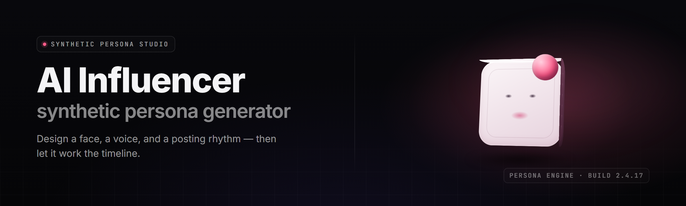

  
  
  

  

  
  

---

**synthetic-persona-forge — AI influencer (synthetic persona) generator, 2026**

**Build a whole synthetic influencer — face, voice, backstory, posting brain — in one `.exe`. No Python. No npm. Extract, run, ship content.**

**synthetic-persona-forge v2.7.3** is the desktop AI influencer (synthetic persona) generator: it forges a complete virtual creator — consistent face, cloned voice, personality core, content calendar, and platform-native captions — then keeps that persona locked across every post, reel, and reply. One binary. One folder of outputs. Zero cloud account required.

---

## 📖 Table of Contents

- [Overview](#overview)
- [What is synthetic-persona-forge?](#what-is-synthetic-persona-forge)
- [The Problem](#the-problem)
- [The Solution](#the-solution)
- [Tips for best results](#tips-for-best-results)
- [Key Features](#key-features)
- [Grouped module catalog](#grouped-module-catalog)
- [All modules status](#all-modules-status)
- [Comparison](#comparison)
- [Quick Start](#quick-start)
- [Installation](#installation)
- [Compatibility / platform support](#compatibility--platform-support)
- [System Requirements](#system-requirements)
- [Known Issues](#known-issues)
- [FAQ](#faq)

---

## 🧭 Overview

**synthetic-persona-forge** is a Windows desktop application that generates and maintains an AI influencer (synthetic persona) end-to-end. You pick an archetype, the forge spins up a face you own (no third-party API), a voice clone, a personality core with a memory bank, and a posting engine that writes captions in that persona's exact tone. Everything routes through one executable, `.exe`, that runs offline by default.

| Category | Details |
|---|---|
| Product type | Desktop `.exe` — AI influencer (synthetic persona) generator |
| Core output | Face model, voice profile, persona brain, content pack |
| Persona persistence | Identity lock keeps the same face + voice across sessions |
| Content formats | Images, short-form video, captions, DM reply drafts |
| Runtime | Offline-first, optional local GPU acceleration |
| Distribution | Project page → download → extract → run the `.exe` |
| License | MIT (community build) |

The forge isn't a chatbot wrapper. It's a persona pipeline: identity generation, voice synthesis, scripted cognition, and scheduling are separate modules that hand data to each other through a shared `persona.json`. Change one trait, and every downstream module re-syncs. That's what keeps a synthetic influencer looking like a *person* and not a slot machine.

---

## 🪪 What is synthetic-persona-forge?

A glossary of what the tool actually does, in the tool's own words.

| Term | Explanation |
|---|---|
| Persona | The full synthetic influencer: face, voice, personality, memory, schedule |
| Identity Lock | Embedding that keeps the same rendered face across all generations |
| Voice Profile | A cloned timbre model built from sample audio or synthesized from scratch |
| Personality Core | Rule + model hybrid that decides tone, slang, and reply style |
| Content Pack | The export folder: images, clips, captions, metadata |
| Posting Brain | Scheduler that decides what goes out, when, and on which platform |
| Archetype | A starting template (fitness, tech, travel, gaming, lifestyle...) |

Bulleted benefits:

- **You own the face.** Rendered locally, no watermark, no per-image billing.
- **Consistency is automatic.** Identity Lock prevents the "different person every post" problem.
- **Captions match the voice.** The Personality Core writes in-character, not generic.
- **One `.exe`, no dependencies.** Extract and run — no Python, no Node, no CLI setup.
- **Offline by default.** Nothing leaves your machine unless you export it.

---

## 🧩 The Problem

Generating a *believable* AI influencer breaks in predictable ways, and every broken way costs you an afternoon:

- The face drifts. Post 1 and Post 40 are visibly different humans.
- The voice is a generic TTS robot that no one follows.
- Captions read like an AI wrote them — because one did, badly.
- You stitch together six tools and a spreadsheet to fake one workflow.
- Memory resets every session, so the persona "forgets" its own backstory.
- Scheduling is manual, so the persona posts at 3 a.m. like a ghost.
- Cross-platform repurposing (Reels → Shorts → TikTok) is copy-paste hell.
- Nothing is reproducible — you can't rebuild the same persona on a new machine.

---

## 🛠️ The Solution

Every pain point above maps to a module that already exists in the forge.

| Problem | Solution |
|---|---|
| Face drifts between posts | **Identity Lock** — one embedding, reused forever |
| Robot voice | **Voice Profile** module — cloned or designed timbre |
| AI-sounding captions | **Personality Core** — in-character caption writer |
| Six tools, one workflow | Single `.exe` with a shared `persona.json` |
| Amnesia between sessions | **Memory Bank** — persistent backstory store |
| Manual posting times | **Posting Brain** — calendar + queue scheduler |
| Platform copy-paste | **Repurpose Engine** — one asset, many ratios |
| Non-reproducible builds | **Persona Seed** — deterministic rebuilds |

---

## 🎯 Tips for best results

- Start from an **Archetype** but edit the backstory before generating content — the Personality Core leans on it.
- Build the **Voice Profile** from at least 90 seconds of clean audio for a stable clone.
- Keep the **Identity Lock** enabled on every batch — disable only when deliberately branching a new look.
- Feed the **Memory Bank** three or four "canon" facts early; consistency compounds over the session.
- Export **PNG + caption sidecars** together so the Repurpose Engine can act on metadata later.
- Run one small batch before a big one — cheap sanity check on face + voice before burning GPU time.
- Pin your **Persona Seed** in `persona.json` before sharing a build with a collaborator.

---

## 🌟 Key Features

A matrix of the headline capabilities, what each does, and why a creator cares.

| Feature | Description | Benefit |
|---|---|---|
| Face Forge | Generates a photorealistic identity from a text archetype prompt | A face you own outright, rendered locally |
| Identity Lock | Reuses the same face embedding across every render | No drift between posts |
| Voice Profile | Builds a cloned or designed voice timbre | A recognizable signature voice |
| Personality Core | In-character tone, slang, and reply engine | Captions that sound human |
| Memory Bank | Persistent backstory and canon store | The persona "remembers" itself |
| Posting Brain | Calendar + queue with per-platform timing | Hands-off scheduling |
| Repurpose Engine | One asset → Reels, Shorts, TikTok ratios | Fewer re-uploads |
| Caption Studio | Platform-native caption + hashtag writer | Faster publishing |
| DM Draft Bot | Drafts in-character replies to comments | Higher engagement loops |
| Persona Seed | Deterministic rebuild token | Reproducible personas |
| Content Pack Export | Bundled images, clips, captions, metadata | One tidy output folder |
| Safety Filter | Local content-policy pre-check on outputs | Fewer platform strikes |

---

## 🗂️ Grouped module catalog

Organized by what each cluster of modules does for the synthetic influencer pipeline.

**🧬 Identity & Face**
- **Face Forge** — generates the base identity from an archetype prompt.
- **Identity Lock** — freezes the face embedding for reuse.
- **Expression Engine** — drives poses, angles, and micro-expressions.
- **Wardrobe Studio** — consistent outfit swaps tied to the identity.
- **Scene Composer** — places the persona in backgrounds that fit the niche.

**🗣️ Voice & Speech**
- **Voice Profile** — builds a cloned or designed timbre.
- **Prosody Tuner** — adjusts pace, pitch, and energy per archetype.
- **Lip-Sync Driver** — matches mouth motion to the voice track.
- **Accent Layers** — regional flavor for the persona's speech.

**🧠 Persona Cognition**
- **Personality Core** — tone, slang, and reply style engine.
- **Memory Bank** — persistent backstory and canon facts.
- **Opinion Matrix** — keeps the persona's takes internally consistent.
- **Trait Dial** — sliders for warmth, edge, humor, and formality.

**📅 Posting & Automation**
- **Posting Brain** — calendar and per-platform queue.
- **Repurpose Engine** — one asset into many platform ratios.
- **Caption Studio** — in-character caption and hashtag writer.
- **DM Draft Bot** — drafts comment and DM replies.
- **Batch Scheduler** — queues a week of content in one run.

**🧰 Tooling & Output**
- **Content Pack Export** — bundled outputs with metadata sidecars.
- **Persona Seed** — a token that reproduces the build deterministically.
- **Safety Filter** — local pre-check on outputs before export.
- **Backup Vault** — versioned snapshots of `persona.json` and assets.

---

## 📟 All modules status

The full module roster and its current state in v2.7.3.

| Module | Status | Description |
|---|---|---|
| Face Forge | ✅ Working | Archetype → photorealistic identity render |
| Identity Lock | ✅ Working | Face embedding reuse across batches |
| Expression Engine | ✅ Working | Pose and micro-expression control |
| Wardrobe Studio | ✅ Working | Consistent outfit swapping |
| Scene Composer | ✅ Working | Niche-matched background placement |
| Voice Profile | ✅ Working | Cloned or designed voice timbre |
| Prosody Tuner | ✅ Working | Per-archetype pace/pitch/energy |
| Lip-Sync Driver | ✅ Working | Mouth motion matched to audio |
| Accent Layers | ✅ Working | Regional speech flavor |
| Personality Core | ✅ Working | Tone, slang, reply style engine |
| Memory Bank | ✅ Working | Persistent backstory store |
| Opinion Matrix | ✅ Working | Internally consistent hot takes |
| Trait Dial | ✅ Working | Warmth/edge/humor/formality sliders |
| Posting Brain | ✅ Working | Calendar and platform queue |
| Repurpose Engine | ✅ Working | One asset to many ratios |
| Caption Studio | ✅ Working | In-character caption writer |
| DM Draft Bot | ✅ Working | Comment and DM reply drafts |
| Batch Scheduler | ✅ Working | Week-of-content queuing |
| Content Pack Export | ✅ Working | Bundled outputs + metadata |
| Persona Seed | ✅ Working | Deterministic rebuild token |
| Safety Filter | ✅ Working | Local output pre-check |
| Backup Vault | ✅ Working | Versioned persona snapshots |
| Archetype Library | ✅ Working | Ready-made persona templates |
| Caption Hashtag DB | ✅ Working | Niche hashtag suggestion bank |
| Background Asset Pack | ✅ Working | Reusable scene backdrops |
| Voice Denoise Pass | ✅ Working | Cleans sample audio before cloning |
| Identity QA Report | ✅ Working | Drift check across a batch |
| Timeline Previewer | ✅ Working | Plays the queue before export |
| Metadata Injector | ✅ Working | Sidecars for platform upload |
| Multi-Profile Manager | 🟡 Beta | Switch between several personas |
| Cloud Sync Bridge | 🟡 Beta | Optional encrypted persona backup |

---

## ⚖️ Comparison

How the forge stacks up against the usual ways people try to fake a persona.

| Aspect | Alternative | This Tool |
|---|---|---|
| Face consistency | Manual re-prompting, drifts | Identity Lock keeps one face |
| Voice | Generic cloud TTS | Local cloned or designed timbre |
| Captions | Off-the-shelf LLM, sounds generic | Personality Core stays in-character |
| Memory | Resets each session | Memory Bank persists canon |
| Tooling | Six separate apps | One `.exe`, one `persona.json` |
| Scheduling | Manual posting | Posting Brain queue |
| Repurposing | Copy-paste per platform | Repurpose Engine, one asset |
| Reproducibility | Non-deterministic | Persona Seed token |

---

## 🚀 Quick Start

1. 🖱️ **Visit the project page** and grab the latest release.
2. 📦 **Download** the archive and extract it to a folder you own (avoid `Program Files`).
3. ▶️ **Run the `.exe`** — the first launch builds the config folder next to it.
4. 🎭 **Pick an archetype**, tweak the backstory, hit **Forge**.
5. 📤 **Export a Content Pack** and drop the assets into your platforms.

  

---

## 💾 Installation

1. **Get the build.** From the project page, download the current release archive. It's a self-contained folder — nothing installs into your system registry.
2. **Extract in place.** Right-click the archive → **Extract All** → choose a path you control, e.g. `C:\Forge\`. Keep the folder structure intact; the `.exe` looks for its `assets\` and `models\` subfolders beside it.
3. **Run the `.exe`.** Double-click the executable. On first run it writes `persona.json`, a `config\` folder, and an `output\` folder. Windows SmartScreen may flag an unsigned community build — choose **More info → Run anyway** if you trust the source.

---

## 🖥️ Compatibility / platform support

| Platform | Support | Notes |
|---|---|---|
| Windows 11 x64 | ✅ Full | Primary target build |
| Windows 10 x64 (21H2+) | ✅ Full | Supported |
| Windows 10 x86 | ❌ None | 64-bit only |
| NVIDIA GPU (CUDA) | ✅ Accelerated | Faster face + voice render |
| AMD GPU (DirectML) | 🟡 Beta | Slower, functional |
| CPU-only mode | ✅ Works | Expect long render times |
| macOS / Linux | ❌ None | Windows `.exe` only |

---

## 📋 System Requirements

| Component | Minimum | Recommended |
|---|---|---|
| OS | Windows 10 x64 21H2 | Windows 11 x64 23H2+ |
| CPU | Quad-core 2.4 GHz | 8-core 3.4 GHz+ |
| RAM | 8 GB | 32 GB |
| GPU | Integrated, DirectX 12 | NVIDIA RTX 8 GB+ VRAM |
| Storage | 6 GB free | 25 GB SSD |
| Audio | Any output device | For voice preview |

---

## 🩹 Known Issues

| Issue | Fix |
|---|---|
| Face drifts after 30+ renders | Lower batch size; re-lock Identity Lock embedding |
| Voice clone sounds robotic | Feed cleaner audio; run Voice Denoise Pass first |
| SmartScreen blocks the `.exe` | More info → Run anyway; verify the source |
| Captions ignore the backstory | Add canon facts to Memory Bank before generating |
| Export folder stays empty | Check `output\` path in `persona.json` |
| Beta Cloud Sync won't connect | Disable it; feature is optional and still stabilizing |

---

## ❔ FAQ

**Q:** Is it safe to run?
**A:** It's an offline desktop `.exe` — nothing leaves your machine unless you enable the beta Cloud Sync. Treat any unsigned community build with the usual caution.

**Q:** Does it work without a GPU?
**A:** Yes, CPU-only mode works. Face and voice renders just take significantly longer.

**Q:** Do I need Python or Node installed?
**A:** No. The `.exe` is self-contained — download, extract, run.

**Q:** Can I generate multiple personas?
**A:** Yes, via Multi-Profile Manager (beta). Each profile gets its own `persona.json` and output folder.

**Q:** Will the same face appear on every post?
**A:** That's the point of Identity Lock — it reuses one embedding so the persona stays visually identical.

**Q:** Does it post for me automatically?
**A:** Posting Brain queues and schedules content, but you still publish through each platform. It prepares, you push.

Is it safe / does it trip platform bans?

The Safety Filter runs a local content-policy pre-check before export, but platform rules vary and change. The forge helps you avoid obvious issues; it can't guarantee any platform's verdict. Review your outputs.

Can I export without the voice module?

Yes. Disable Voice in the module panel and the Content Pack ships silent clips plus caption sidecars. The Repurpose Engine still works.

Where are my personas stored?

Next to the `.exe`, in the folder it created on first run — `persona.json`, `config\`, and `output\`. Move the whole folder to move the persona.

Does the beta Cloud Sync upload my face data?

Only if you enable it, and only encrypted. Keep it off if you want a fully offline workflow.

Can I rebuild the exact same persona later?

Yes — save the Persona Seed token in `persona.json`. It reproduces the build deterministically on the same version.

---

## 📥 Get the build

**synthetic-persona-forge v2.7.3 — your whole AI influencer, one `.exe`.**

  

---

The forge turns "make me an AI influencer" into a folder you own: a locked face, a signature voice, a persona that remembers its own backstory, and a queue that keeps it posting. It runs offline, ships as one `.exe`, and reproduces the exact same persona whenever you need it. Extract it, forge one, and watch a synthetic creator start sounding like a person.
